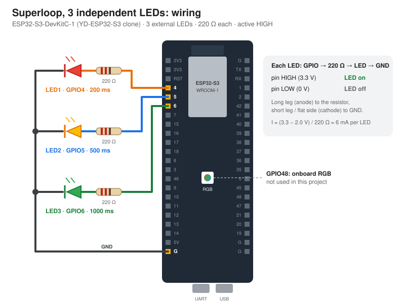

# Lesson 2.3: Superloop and independent tasks

[](https://wokwi.com/projects/479851584497659905)

Beetroot Academy homework ([`TASK.md`](TASK.md)), ESP-IDF v6.0.2 on an ESP32-S3-DevKitC-1.

Three external LEDs blink at different rates, each on its own schedule, from **one non-blocking loop** in `app_main`. No `vTaskDelay`-based blinking and no `while` that waits for time. Every LED checks the clock (`esp_timer_get_time()`, the ESP-IDF version of Arduino's `millis()`) and toggles when its interval has passed.

## Requirements check

| `TASK.md` rule | How the code meets it |
|---|---|
| `delay()` forbidden | No `delay`/`vTaskDelay`-based blinking. Each LED toggles only when `esp_timer_get_time()` says its interval has passed ([`main.c:78`](main/main.c#L78)). |
| No `while()` waiting for time inside `loop()` | The only loop is `while (1)` in `app_main` ([`main.c:70`](main/main.c#L70)). It plays the role of the code that calls Arduino's `loop()` over and over, and its body never waits: each pass checks the clock and moves on with an `if`. |
| `millis()` allowed | `esp_timer_get_time()` is used (µs since boot, `int64_t`). |
| `vTaskDelay(1)` at the end of a pass | It's a one-tick **yield** so the idle task can feed the task watchdog. The schedule doesn't depend on it ([`main.c:102`](main/main.c#L102)). |

## How the intervals are read

"LED1 blinks every 200 ms" is read as **the LED toggles every 200 ms**: 200 ms on, 200 ms off. One full blink (on + off) therefore takes **2 × the interval**.

| LED | GPIO | Toggles every | Full period (on + off) |
|---|---|---|---|
| LED1 | GPIO4 | 200 ms | 400 ms |
| LED2 | GPIO5 | 500 ms | 1000 ms |
| LED3 | GPIO6 | 1000 ms | 2000 ms |

## How the code works

All three LEDs live in one array of structs in [`main/main.c`](main/main.c). Each struct holds the LED's pin, its interval, the time it last toggled and its current level. The superloop runs the same check for every LED:

```c
if (now_us - led->last_toggle_us >= led->interval_us) {
    // toggle the LED, then move its clock forward by exactly one interval
    led->last_toggle_us += led->interval_us;
}
```

- `last_toggle_us += interval_us` (not `= now_us`) keeps each LED on its original schedule, so small delays don't add up over time.
- The level is kept in the struct, because `gpio_get_level()` reads 0 on a pin set to `GPIO_MODE_OUTPUT` (its input buffer is off).
- `vTaskDelay(1)` at the end of each pass is **not** used for timing. It only gives the idle task a tick so the task watchdog doesn't fire. With the 100 Hz tick, a toggle can therefore be up to about 10 ms late, but it never drifts.

## Wiring



Each LED: GPIO → 220 Ω resistor → LED anode (long leg), LED cathode (short leg) → GND. HIGH = on.

| LED | Board pin (silkscreen label) | Resistor | Return |
|---|---|---|---|
| LED1 | 4 | 220 Ω | GND |
| LED2 | 5 | 220 Ω | GND |
| LED3 | 6 | 220 Ω | GND |

Find the pins by the GPIO numbers printed next to them on the board. Logic is 3.3 V, and each LED draws about (3.3 − 2.0) / 220 ≈ 6 mA (assuming a red LED with Vf ≈ 2.0 V).

## Build and flash

Activate the ESP-IDF environment in the same PowerShell window, then:

```powershell
idf.py build
idf.py -p COM5 flash monitor
```

Exit the monitor with `Ctrl+]`.

## Simulate in Wokwi

**[▶ Open the Wokwi project](https://wokwi.com/projects/479851584497659905)** and press the green ▶ button. The first build can take a minute or two on Wokwi's free servers. Then watch the three LEDs blink at their own rates.

The Wokwi project runs this repo's own C code. Wokwi compiles ESP-IDF code with the Arduino ESP32 core, which already has its own `app_main()`. So [`wokwi/sketch.ino`](wokwi/sketch.ino) calls our `app_main`, renamed to `lesson_2_3_diods_app_main` in the Wokwi copy of `main.c`; see [`wokwi/README.md`](wokwi/README.md). The `ESP_LOGI` messages don't appear in Wokwi's serial monitor, so watch the LEDs instead.

- **VS Code:** install the *Wokwi Simulator* extension, run `idf.py build`, then run *Wokwi: Start Simulator*. This runs the real firmware: [`wokwi.toml`](wokwi.toml) points to the build, and [`diagram.json`](diagram.json) holds the circuit.

Wokwi blends LED brightness over about 100 ms, so in the simulator an LED's "on" time looks about 100 ms shorter and its "off" time about 100 ms longer. The full period (on + off) is not affected.

## Expected serial log

This is the **expected** output, not a measured one. The absolute times depend on how long the board takes to boot. Check the gaps: LED1 every 200 ms, LED2 every 500 ms, LED3 every 1000 ms, each up to about 10 ms late. When several LEDs are due on the same pass, they print together.

```
I (300) leds: 3 LEDs ready, starting the superloop
I (500) leds: LED1 -> ON  at 500 ms
I (700) leds: LED1 -> OFF at 700 ms
I (800) leds: LED2 -> ON  at 800 ms
I (900) leds: LED1 -> ON  at 900 ms
I (1100) leds: LED1 -> OFF at 1100 ms
I (1300) leds: LED1 -> ON  at 1300 ms
I (1300) leds: LED2 -> OFF at 1300 ms
I (1300) leds: LED3 -> ON  at 1300 ms
```

The log prints about 8 lines per second (5 + 2 + 1 toggles), which is easy for the 115200-baud console.

## Execution results

### Wokwi simulation

Measured on 2026-11-05 in the [Wokwi project](https://wokwi.com/projects/479851584497659905) by timing the simulated LED edges for 6 s. Each pair is one on + one off time:

| LED | Toggle every | Full period expected | Full period in Wokwi (examples) |
|---|---|---|---|
| LED1 | 200 ms | 400 ms | 98 + 298 = 396, 103 + 297 = 400, 104 + 300 = 404 ms |
| LED2 | 500 ms | 1000 ms | 397 + 602 = 999, 401 + 597 = 998, 401 + 601 = 1002 ms |
| LED3 | 1000 ms | 2000 ms | 900 + 1097 = 1997, 906 + 1098 = 2004 ms |

All three LEDs ran at the same time, each at its own rate. The uneven on/off split (about 100/300 ms instead of 200/200 ms) comes from Wokwi's LED smoothing; see [Simulate in Wokwi](#simulate-in-wokwi).

### Board

_To be added: the serial log from the real board (`idf.py -p COM5 monitor`)._
